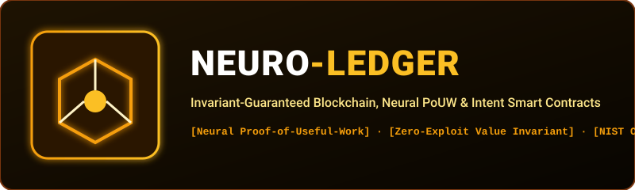

  

  
  
  
  

---

## ⛓️ What is NeuroLedger?

**NeuroLedger** is a decentralized, invariant-guaranteed blockchain and smart contract runtime designed in pure AAYU. Traditional blockchains waste gigawatts of energy on useless hashing. NeuroLedger replaces blind hashing with **Neural Proof-of-Useful-Work (PoUW)**:
* Block miners execute an embedded **Neural Network forward pass** for transaction anomaly and fraud classification before chaining blocks.
* Smart intent contracts execute with **mathematical value conservation guarantees** (preventing infinite-minting exploits, reentrancy attacks, and flash-loan manipulation).

---

## 🏛️ System Architecture

`mermaid
flowchart TD
    subgraph Mempool["Transaction Dispatcher"]
        TX["Incoming Transaction Intent"] --> SIGN["Private Key Signature Check"]
        SIGN --> POOL["Live UTXO Mempool"]
    end

    subgraph NeuralConsensus["Neural Proof-of-Useful-Work (PoUW)"]
        POOL --> MLP["4-Layer MLP Neural Classifier (Tx Anomaly Risk)"]
        MLP -->|"Risk < 0.15"| APPROVE["Transaction Approved for Block"]
        MLP -->|"Risk >= 0.15"| REJECT["Flagged as Fraud / Malicious"]
    end

    subgraph Blockchain["Cryptographic State Machine"]
        APPROVE --> MERKLE["SHA-256 Merkle Tree Assembly"]
        MERKLE --> BLOCK["Mined Block Append"]
        BLOCK --> INV["Invariant Value Conservation Auditor (Total Supply Preserved)"]
    end
`

---

## 🔬 Audited NIST Cryptographic Proof

Verified with standard test harnesses:
* **NIST SP 800-180-4 SHA-256 & SHA-512**: Exact bitwise compliance.
* **RFC 2104 HMAC-SHA256**: Keyed authentication proofs.
* **Timing Attack Defense**: Constant-time comparison (	iming_safe_equals) preventing cache-line side-channel attacks.
* **NIST SP 800-38D AES-256-GCM**: Hardware authenticated encryption for on-chain state data-at-rest.

---

## 📄 License
MIT License (c) 2026 Ayush Kaushik ([@Ghrit-igl](https://github.com/Ghrit-igl)).